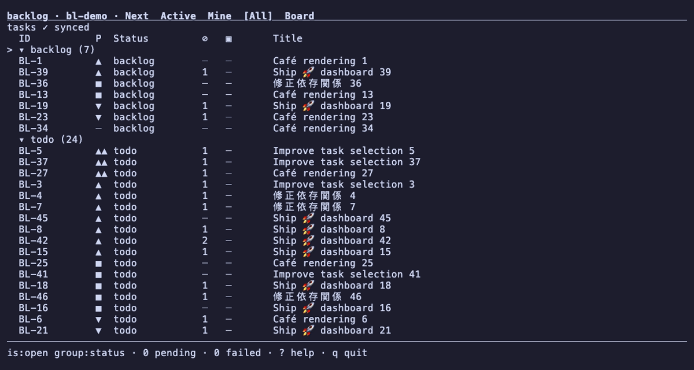

<p align="center">
  
</p>

<h1 align="center">backlog</h1>

`bl` is a keyboard-first terminal backlog for people and coding agents. Tasks are
Markdown files in Git; linked worktrees share one live queue.



## Quickstart

Install a binary with the [user guide](docs/guide.md#install), or build from source
with [Development](docs/development.md#setup). Inside a Git repository, with `bl`
on PATH:

```sh
bl init
bl new 'Ship the first feature !high #release' --ac 'Feature works'
bl ls
bl show BL-1 --json
bl next --explain --json
```

Run `bl` in a terminal. `j`/`k` move, `enter` opens detail, `gt` switches views,
`5` opens the board, `/` filters, `n` creates, `?` shows keys, and `q` quits.
CLI commands return a versioned envelope with `--json`; `bl instructions workflow`
prints the installed version's agent protocol.

Native files, [direct Backlog.md editing](docs/backlog-md.md), Backlog.md import,
local Beads, GitHub Issues with Projects v2, [Linear](docs/linear.md), external
adapters, CLI/MCP, the TUI, hooks, actions, and optional Worklease coordination
are available. Detected Backlog.md projects open read-only until configured.
The Jira adapter is still being implemented; see [remote adapter status](docs/remote.md).

## Docs

- [User guide](docs/guide.md): install, import, TUI, agents, configuration, automation
- [Design](docs/design.md): decisions, architecture, budgets, milestones
- [Native format](docs/format.md)
- [Query language](docs/query.md)
- [CLI commands](docs/cli.md)
- [TUI and keymap](docs/tui.md)
- [Readiness and ranking](docs/readiness.md)
- [Backlog.md source](docs/backlog-md.md) and [import](docs/import.md)
- [Beads](docs/beads.md)
- [Remote adapters](docs/remote.md) and [OAuth qualification](docs/oauth.md) (planned, not shipped)
- [GitHub setup](docs/github.md) and [live verification](docs/github-verification.md)
- [Linear setup](docs/linear.md) and [live verification](docs/linear-verification.md)
- [External adapter protocol v1](docs/external-adapter-protocol.md) and [wire schema](docs/external-adapter/v1/schema.json)
- [MCP](docs/mcp.md)
- [Events](docs/events.md)
- [Hooks, actions, and agent handoff](docs/automation.md)
- [Performance measurements](docs/benchmarks.md)
- [TUI stack spike](docs/spikes/tui-stack.md)
- [Development and releases](docs/development.md)
- [Project config schema](docs/schemas/project-config.json)
- [User config schema](docs/schemas/user-config.json)
- [Demo tape](docs/demo.tape) and [recording instructions](docs/guide.md#demo)
